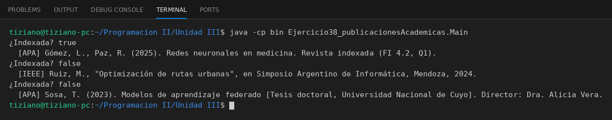

# PublicacionAcademica

Programación II - Unidad 3 - Ejercicio 38

## Consigna
Modelar una jerarquía de clases con herencia: una clase base y subclases que reutilizan código con `super` y sobrescriben métodos. Publicaciones académicas con distintos formatos de cita.

## Lógica
- Base con título, fecha y lista de autores; `validarIndexacion()` y `generarCita()`.
- `ArticuloIndexado` (APA), `ActaCongreso` (IEEE) y `TesisDoctoral` (APA) reescriben la cita.
- `Main` imprime las referencias.

## Ejecución

